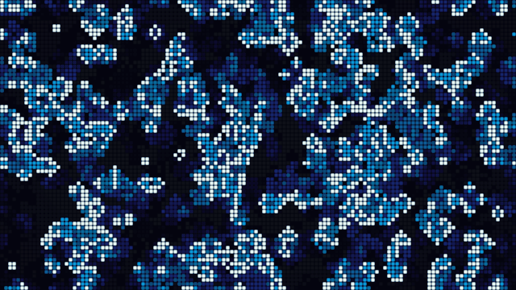
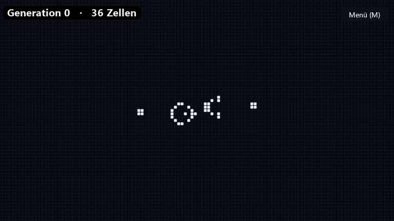
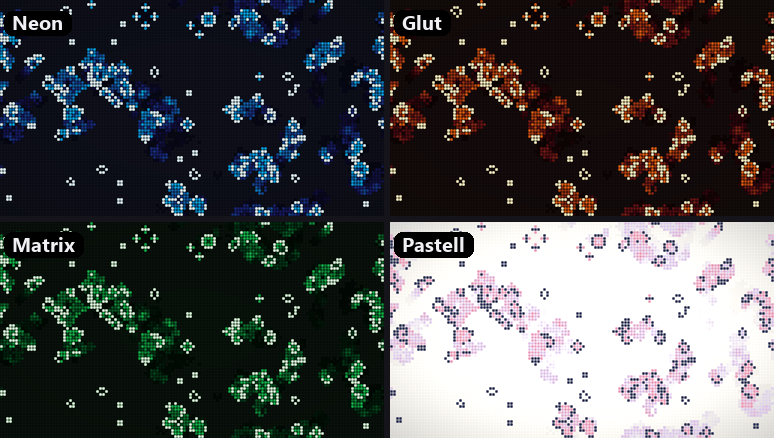
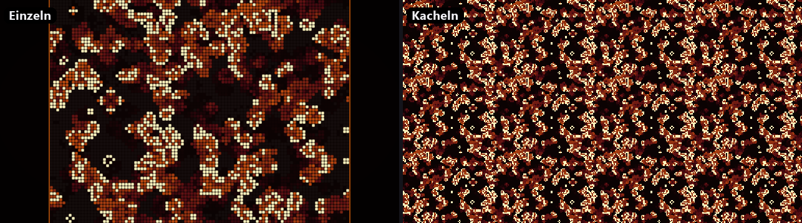
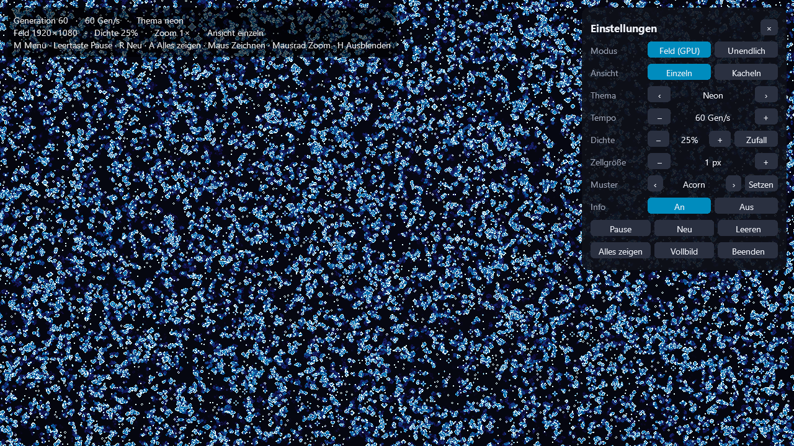

# Conway's Game of Life

A fast, interactive implementation of ***Conway's Game of Life*** in Python. It has two engines:
a **GPU field** that simulates screen-sized worlds at tens of thousands of generations per second,
and an **unbounded HashLife universe** that jumps billions of generations ahead.



## Features

- **GPU simulation**: 32 cells per texel with bitwise neighbour counting in a fragment shader.
  A 4K field runs at over 20,000 generations per second.
- **Unbounded mode (HashLife)**: Gosper's algorithm with memoised quadtrees. A glider gun reaches
  10¹² generations in a fraction of a second.
- **Fits your screen**: starts in fullscreen at your resolution with one cell per pixel. The cell
  size is adjustable, and multiple monitors are supported.
- **Looks good**: colour themes, glowing trails behind dying cells, rounded cells when zoomed in.
- **Fully interactive**: draw with the mouse, zoom to the cursor, pan, and change every setting in
  the in-game menu.
- **Easy on the battery**: the window only redraws when something changes, so a paused game uses
  almost no CPU or GPU.

## Unbounded mode

HashLife runs on an infinite plane. Here the Gosper glider gun is followed for one million
generations while the view keeps zooming out:



Built-in patterns (menu → **Muster**): Acorn, R-Pentomino, Gosper glider gun, Diehard, Glider.
They work in both modes. HashLife is fastest on regular patterns. Chaotic phases, such as Acorn's
first 5,000 generations, take noticeably longer.

## Themes and views



There is also `klassik`, plain black and white. The field is a torus: cells leaving one edge come
back on the opposite edge. There are two views:



- **Einzeln** (default): the field is shown once with a frame. You can zoom out only until the
  whole field fits.
- **Kacheln**: the field repeats endlessly in every direction.

## Installation

Requires Python 3.10+ and a graphics driver with OpenGL 3.3.

```bash
python -m venv .venv
.venv\Scripts\activate          # Windows
source .venv/bin/activate       # Linux / macOS

pip install -r requirements.txt        # to play
pip install -r requirements-dev.txt    # to run the tests as well
```

## Running

```bash
python main.py
```

On Windows you can create a desktop shortcut with the app icon that starts without a console
window (run once):

```powershell
powershell -ExecutionPolicy Bypass -File create_shortcut.ps1             # desktop
powershell -ExecutionPolicy Bypass -File create_shortcut.ps1 -StartMenu  # + start menu
```

## Menu and controls

Click **Menü** in the top-right corner or press `M`. All settings can be changed while the game
is running. The menu is in German.



| Input | Action |
|---|---|
| `M` / `Tab` | open / close the menu |
| `Space` | pause / resume |
| `N` | single step (while paused) |
| `W` / `S` | double / halve speed |
| `R` | new random field (unbounded mode: restart the pattern) |
| `C` | clear |
| `U` | switch mode: field (GPU) ↔ unbounded (HashLife) |
| `K` | switch view: single ↔ tiles (field mode) |
| `A` | show everything (whole field / all live cells) |
| `T` | next colour theme |
| `H` | show / hide the info overlay (off by default) |
| Left / right mouse (drag) | draw / erase cells |
| Mouse wheel, `+` / `-` | zoom (the wheel zooms around the cursor) |
| Middle mouse (drag), arrow keys | pan |
| `Home` | reset the view |
| `F11` | toggle fullscreen |
| `Esc` | close the menu, otherwise quit |

## Command-line options

All options are optional and only set the starting values:

| Option | Meaning | Default |
|---|---|---|
| `--density 0.2` | share of live cells at start / reset (0–1) | random, 5–40 % |
| `--speed 120` | generations per second | 60 |
| `--cell 4` | cell size in screen pixels (the field still fills the screen) | 1 |
| `--grid 4000x4000` | field size in cells, overrides `--cell` | screen resolution / cell size |
| `--window 1600x900` | start in a window instead of fullscreen | fullscreen |
| `--screen 1` | which monitor to use | primary |
| `--theme glut` | `neon`, `glut`, `matrix`, `pastell`, `klassik` | `neon` |
| `--view kacheln` | `einzeln` or `kacheln` | `einzeln` |
| `--hud` | show the info overlay at start | off |
| `--seed 42` | random seed for reproducible fields | random |

## Performance

These numbers were measured on the development machine. Your results will depend on the GPU.

| Field | Generations / s |
|---|---|
| 1920×1080 | ~21,600 |
| 3840×2160 | ~23,400 |
| 16384×16384 (268 M cells) | ~700 |

On small fields the limit is the Python call per generation, not the GPU.

## How it works

| File | Purpose |
|---|---|
| `main.py` | window, rendering, input, command-line options |
| `gpu_life.py` | GPU engine: bit-packed state (`GL_R32UI`, 32 cells per texel), one shader pass per generation, bit-sliced neighbour adder, separate heat texture for the trails |
| `hashlife.py` | HashLife engine (hash-consed quadtree, memoised `successor`), RLE parser, built-in patterns |
| `life.py` | numpy reference implementation, used to seed the field and as ground truth in the tests |
| `ui.py` | the clickable in-game menu |
| `tests/` | rules, GPU vs. numpy (word borders, torus edges), HashLife vs. numpy, known pattern facts |

Run the tests with `pytest`.

## License

MIT © 2023-2026 Willi Müller. See [LICENSE](LICENSE).
